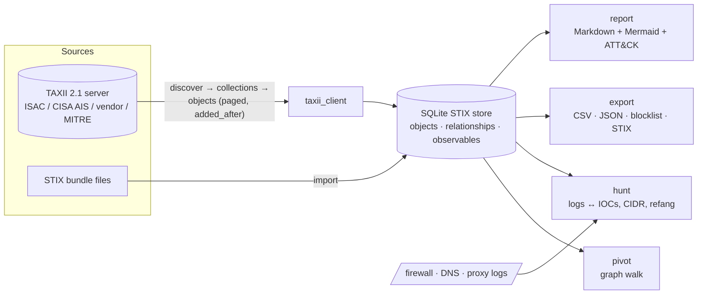

# stixflow

**A STIX 2.1 / TAXII 2.1 threat-intelligence pipeline with an ICS/OT focus.**
Pull intel from a TAXII server, store it with proper STIX versioning, pivot across the relationship graph, hunt for indicators in plant-floor logs, and produce reports a SOC or controls team can act on.


---

## Why this exists

Most CTI tooling is built for enterprise IT. On a manufacturing floor, the questions are different:

- *Is anything on the OT side talking to known adversary infrastructure?*
- *If this IP is bad, which malware and which group is behind it, and which **ICS ATT&CK techniques** does that imply for my PLCs and HMIs?*
- *Which mitigations (segmentation, Modbus write allow-listing, MFA on vendor VPN) cover those techniques?*

stixflow answers those questions end to end using the two open standards that make threat-intel sharing machine-readable:

| Standard | Role | In this project |
|---|---|---|
| **STIX 2.1** | The *language*. JSON objects (indicator, malware, intrusion-set, attack-pattern…) plus `relationship` objects that link them. | `store.py` versions and indexes objects; `patterns.py` turns indicator patterns into hunt-able IOCs. |
| **TAXII 2.1** | The *transport*. A REST API for discovering collections and pulling or pushing STIX objects. | `taxii_client.py` is written against the spec directly; `server.py` is a working TAXII 2.1 server for demos and tests. |

## Architecture



## Features

- **Spec-level TAXII 2.1 client**: discovery, API roots, collections, `more`/`next` pagination, `added_after` incremental sync with a saved cursor per feed, `match[type]` filtering, HTTP Basic auth, push (`POST objects`) with status handling.
- **Bundled TAXII 2.1 server**: serves any folder of STIX bundles as collections. It implements pagination, filters, `X-TAXII-Date-Added-*` headers, manifest, get-by-id, POST plus status, auth, `Accept` negotiation and TAXII error bodies. You can demo and test with no external dependency.
- **Correct STIX versioning**: the newest `modified` wins, so re-pulls are idempotent. Revoked objects are kept for the record but never alert or export.
- **Pattern → IOC extraction**: IPv4/IPv6 (including CIDR), domains, URLs, emails, and file hashes with their algorithm, taken from `OR`/`AND` compound patterns.
- **Graph pivoting**: `IP → indicator → malware → intrusion set → threat actor / campaign → techniques → mitigations`.
- **Log hunting**: works on any text log. It refangs `hxxp` and `[.]`, checks CIDR containment, skips revoked indicators, and adds adversary context to each hit. `--fail-on-hit` sets the exit code so cron jobs and CI can alert.
- **Reports**: a GitHub-renderable Markdown report with ATT&CK technique and mitigation tables plus a Mermaid relationship graph ([example](docs/sample_hunt_report.md)).
- **Tested against real data**: it imports MITRE's full ATT&CK for ICS STIX bundle (about 2,500 objects) in under a second.

## Quick start

```bash
git clone https://github.com/<your-username>/stixflow && cd stixflow
python -m venv .venv && source .venv/bin/activate
pip install -e ".[dev]"

# terminal 1 - local TAXII 2.1 server with the sample ICS feed
stixflow serve --port 5000

# terminal 2 - full pipeline
stixflow discover http://127.0.0.1:5000
stixflow pull     http://127.0.0.1:5000            # run again: only new objects come down
stixflow stats
stixflow pivot    203.0.113.45 --depth 3
stixflow hunt     samples/plant_firewall.log --report reports/hunt_report.md
stixflow export   -f txt -o reports/blocklist.txt  # firewall EDL / DNS sinkhole list
stixflow report   -o reports/intel_report.md
```

Or `make serve` in one terminal and `make demo` in another.

### Example: pivot from an IP seen in a firewall log

```
$ stixflow pivot 203.0.113.45 --depth 3
PRESSBREAK C2 server indicator
└── -> indicates PRESSBREAK malware
    ├── -> targets Discrete Manufacturing (Metal Stamping) identity
    ├── -> uses T0843 Program Download attack-pattern
    ├── -> uses T0836 Modify Parameter attack-pattern
    │   └── <- mitigates M0937 Filter Network Traffic course-of-action
    ├── -> uses T0855 Unauthorized Command Message attack-pattern
    ├── <- uses COPPER LATHE intrusion-set
    │   ├── -> attributed-to COPPER LATHE Operators threat-actor
    │   ├── -> uses GRIDSWEEP tool
    │   ├── -> uses T0883 Internet Accessible Device attack-pattern
    │   ├── -> uses T0886 Remote Services attack-pattern
    │   └── <- attributed-to Operation QUIET TONNAGE campaign
    ...
```

### Example: hunt

The sample log tells a short intrusion story: vendor-VPN brute force, then C2 beaconing from an engineering workstation, then a payload download, then **Modbus register writes to a press-line PLC from that same workstation**. A revoked (sinkholed) indicator in the log correctly does **not** alert. See [`docs/sample_hunt_report.md`](docs/sample_hunt_report.md).

## Using real feeds

```bash
# MITRE ATT&CK for ICS as a STIX bundle (techniques, groups, malware, mitigations)
curl -LO https://raw.githubusercontent.com/mitre-attack/attack-stix-data/master/ics-attack/ics-attack.json
stixflow import ics-attack.json
stixflow pivot Triton
stixflow report --title "ATT&CK for ICS overview" -o reports/ics_attack.md

# Any TAXII 2.1 server (ISAC, vendor, CISA AIS, MITRE's ATT&CK TAXII server, ...)
export TAXII_USER=... TAXII_PASSWORD=...
stixflow discover https://taxii.example.org
stixflow pull https://taxii.example.org --collection "<collection id or title>"
```

## CLI reference

| Command | Purpose |
|---|---|
| `serve` | Run the demo TAXII 2.1 server (`--data-dir`, `--user/--password`) |
| `discover URL` | List API roots and collections |
| `pull URL` | Pull collections into the store (incremental; `--full`, `--added-after`, `--type`) |
| `push URL -c ID FILE` | POST a bundle to a writable collection |
| `import FILE...` | Load STIX bundle files |
| `stats` | Object counts by type |
| `pivot QUERY` | Walk the graph from an IOC value, STIX id, or name |
| `hunt LOG...` | Match IOCs in logs (`--report`, `--fail-on-hit`) |
| `export -f csv\|json\|txt\|stix` | IOC exports or a STIX bundle |
| `report` | Markdown intel report |

All commands accept `--db PATH` (default `stixflow.db`, or the `STIXFLOW_DB` environment variable).

## Project layout

```
src/stixflow/
  taxii_client.py   TAXII 2.1 client (requests)
  server.py         TAXII 2.1 demo server (Flask)
  store.py          SQLite STIX store, versioning, graph walk
  patterns.py       STIX pattern -> observables
  hunt.py           log matching, refang, CIDR
  export.py         csv / json / blocklist / stix
  report.py         Markdown + Mermaid report
  cli.py            argparse + rich CLI
  data/             sample STIX bundles (generated)
scripts/generate_sample_data.py
samples/plant_firewall.log
tests/              30 tests, incl. real HTTP client<->server round-trips
```

## Design decisions

- **The TAXII client is hand-written and does not wrap `taxii2-client`.** The point of the project is to show the protocol mechanics: media types, envelopes, pagination, and cursoring.
- **SQLite instead of a graph database.** Relationships go in an indexed edge table, which makes pivots a few indexed queries. It has no infrastructure and is a single file you can hand to someone.
- **The store holds observables in parsed form.** Patterns are parsed once at ingest, so hunting large logs is a dictionary-style lookup and not a regex per indicator per line.
- **Only equality comparisons become IOCs.** `LIKE`, `MATCHES` and temporal qualifiers are kept in the stored object but not loaded into blocklists, because that is how false-positive storms start.

## Sample data disclaimer

The bundled scenario (COPPER LATHE, PRESSBREAK, GRIDSWEEP, LOCKSTEP) is **fictional**. All IPs come from RFC 5737 documentation ranges, all domains use the reserved `.example` TLD, and the hashes are digests of throwaway strings. ATT&CK technique and mitigation IDs are real public identifiers, so the output maps to the framework. Regenerate the data with `python scripts/generate_sample_data.py`.

## Roadmap

- [ ] Sightings: write `sighting` SROs back to TAXII when a hunt hits
- [ ] Zeek `conn.log` / `dns.log` and Windows EVTX parsers
- [ ] Suricata rule and Splunk lookup exports
- [ ] Optional LLM-generated executive summary of the report
- [ ] TLP-aware export filtering

## License

MIT
