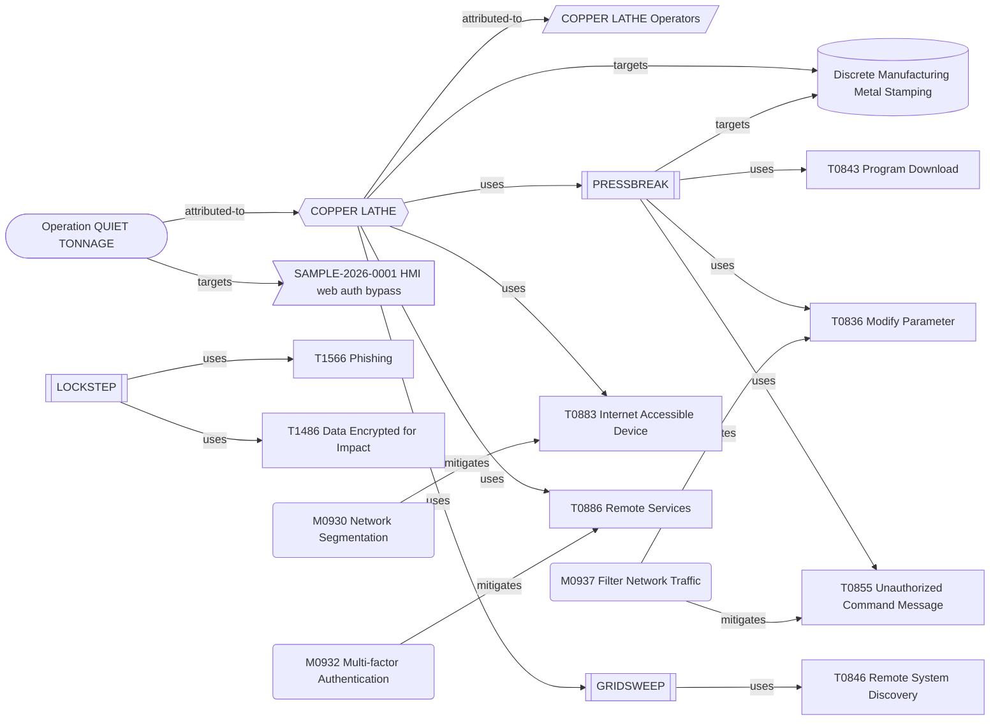

# Hunt Report

_Generated by stixflow on 2026-11-23 21:11 UTC from `stixflow.db`_

## Collection summary

| STIX type | Count |
|---|---:|
| `relationship` | 30 |
| `indicator` | 11 |
| `attack-pattern` | 8 |
| `course-of-action` | 3 |
| `identity` | 2 |
| `malware` | 2 |
| `campaign` | 1 |
| `intrusion-set` | 1 |
| `threat-actor` | 1 |
| `tool` | 1 |
| `vulnerability` | 1 |

## Hunt results

**14 match(es)** across 9 log line(s).

| Line | Observed | Matched indicator | Linked to |
|---:|---|---|---|
| 4 | `192.0.2.77` | Vendor VPN brute-force source (`192.0.2.77`) | campaign: Operation QUIET TONNAGE; intrusion-set: COPPER LATHE; threat-actor: COPPER LATHE Operators |
| 5 | `192.0.2.77` | Vendor VPN brute-force source (`192.0.2.77`) | campaign: Operation QUIET TONNAGE; intrusion-set: COPPER LATHE; threat-actor: COPPER LATHE Operators |
| 6 | `203.0.113.45` | PRESSBREAK C2 server (`203.0.113.45`) | malware: PRESSBREAK; intrusion-set: COPPER LATHE; threat-actor: COPPER LATHE Operators |
| 6 | `update-plcsync.example` | PRESSBREAK C2 domain (`update-plcsync.example`) | malware: PRESSBREAK; intrusion-set: COPPER LATHE; threat-actor: COPPER LATHE Operators |
| 7 | `203.0.113.45` | PRESSBREAK C2 server (`203.0.113.45`) | malware: PRESSBREAK; intrusion-set: COPPER LATHE; threat-actor: COPPER LATHE Operators |
| 7 | `update-plcsync.example` | PRESSBREAK C2 domain (`update-plcsync.example`) | malware: PRESSBREAK; intrusion-set: COPPER LATHE; threat-actor: COPPER LATHE Operators |
| 8 | `203.0.113.45` | PRESSBREAK C2 server (`203.0.113.45`) | malware: PRESSBREAK; intrusion-set: COPPER LATHE; threat-actor: COPPER LATHE Operators |
| 8 | `http://update-plcsync.example/fw/patch.bin` | PRESSBREAK payload URL (`http://update-plcsync.example/fw/patch.bin`) | malware: PRESSBREAK; intrusion-set: COPPER LATHE; threat-actor: COPPER LATHE Operators |
| 8 | `update-plcsync.example` | PRESSBREAK C2 domain (`update-plcsync.example`) | malware: PRESSBREAK; intrusion-set: COPPER LATHE; threat-actor: COPPER LATHE Operators |
| 9 | `7ed11a99d06a63e9b27f4321fee1983b21f2a654a94defd6da089c91c60faf0f` | PRESSBREAK loader (SHA-256) (`7ed11a99d06a63e9b27f4321fee1983b21f2a654a94defd6da089c91c60faf0f`) | malware: PRESSBREAK; intrusion-set: COPPER LATHE; threat-actor: COPPER LATHE Operators |
| 10 | `198.51.100.17` | COPPER LATHE staging range (`198.51.100.0/24`) | tool: GRIDSWEEP; intrusion-set: COPPER LATHE; threat-actor: COPPER LATHE Operators |
| 12 | `invoice-portal.example` | LOCKSTEP phishing domain (`invoice-portal.example`) | malware: LOCKSTEP |
| 13 | `ap-billing@invoice-portal.example` | LOCKSTEP sender (`ap-billing@invoice-portal.example`) | malware: LOCKSTEP |
| 13 | `invoice-portal.example` | LOCKSTEP phishing domain (`invoice-portal.example`) | malware: LOCKSTEP |

## Adversary activity

### Operation QUIET TONNAGE (`campaign`)

- **attributed-to:** COPPER LATHE
- **targets:** SAMPLE-2026-0001 HMI web auth bypass

### COPPER LATHE (`intrusion-set`)

Fictional intrusion set targeting stamping plants via exposed remote-access gear.

- **attributed-to:** COPPER LATHE Operators
- **attributed-to (inbound):** Operation QUIET TONNAGE
- **targets:** Discrete Manufacturing (Metal Stamping)
- **uses:** GRIDSWEEP, PRESSBREAK, T0883 Internet Accessible Device, T0886 Remote Services

### COPPER LATHE Operators (`threat-actor`)

Fictional group extorting manufacturers by threatening production quality.

- **attributed-to (inbound):** COPPER LATHE

## ATT&CK techniques

| ID | Technique | Used by | Mitigations |
|---|---|---|---|
| T0836 | Modify Parameter | PRESSBREAK | M0937 Filter Network Traffic |
| T0843 | Program Download | PRESSBREAK | - |
| T0846 | Remote System Discovery | GRIDSWEEP | - |
| T0855 | Unauthorized Command Message | PRESSBREAK | M0937 Filter Network Traffic |
| T0883 | Internet Accessible Device | COPPER LATHE | M0930 Network Segmentation |
| T0886 | Remote Services | COPPER LATHE | M0932 Multi-factor Authentication |
| T1486 | Data Encrypted for Impact | LOCKSTEP | - |
| T1566 | Phishing | LOCKSTEP | - |

## Indicators of compromise

| Type | Value | Indicator | Indicates |
|---|---|---|---|
| domain | `invoice-portal.example` | LOCKSTEP phishing domain | LOCKSTEP |
| domain | `update-plcsync.example` | PRESSBREAK C2 domain | PRESSBREAK |
| email | `ap-billing@invoice-portal.example` | LOCKSTEP sender | LOCKSTEP |
| hash | `7ed11a99d06a63e9b27f4321fee1983b21f2a654a94defd6da089c91c60faf0f` | PRESSBREAK loader (SHA-256) | PRESSBREAK |
| hash | `ed40ddf37c04b04a418626fc7dc7cd78dcedbc3f4bed105b2025191f4f3eaf23` | LOCKSTEP encryptor (SHA-256) | LOCKSTEP |
| ipv4 | `192.0.2.77` | Vendor VPN brute-force source | Operation QUIET TONNAGE |
| ipv4 | `198.51.100.0/24` | COPPER LATHE staging range | GRIDSWEEP |
| ipv4 | `198.51.100.200` | LOCKSTEP exfil server | LOCKSTEP |
| ipv4 | `203.0.113.45` | PRESSBREAK C2 server | PRESSBREAK |
| ipv4 | `203.0.113.46` | PRESSBREAK backup C2 pair | PRESSBREAK |
| ipv4 | `203.0.113.47` | PRESSBREAK backup C2 pair | PRESSBREAK |
| url | `http://update-plcsync.example/fw/patch.bin` | PRESSBREAK payload URL | PRESSBREAK |

## Relationship graph

